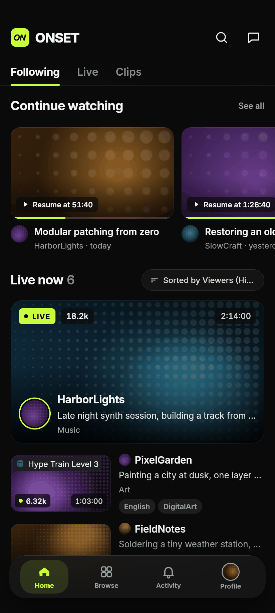
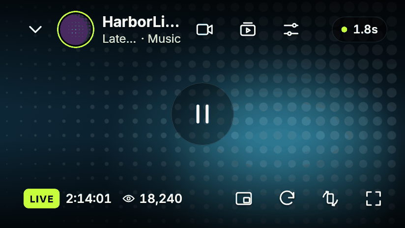
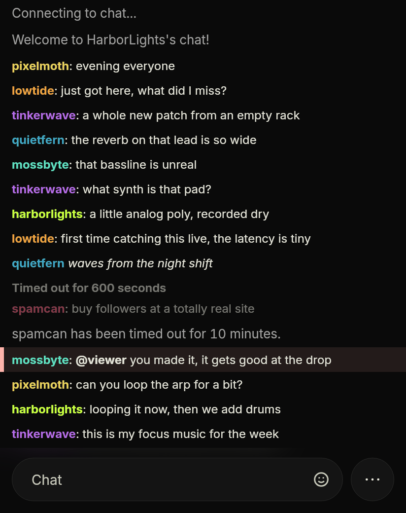
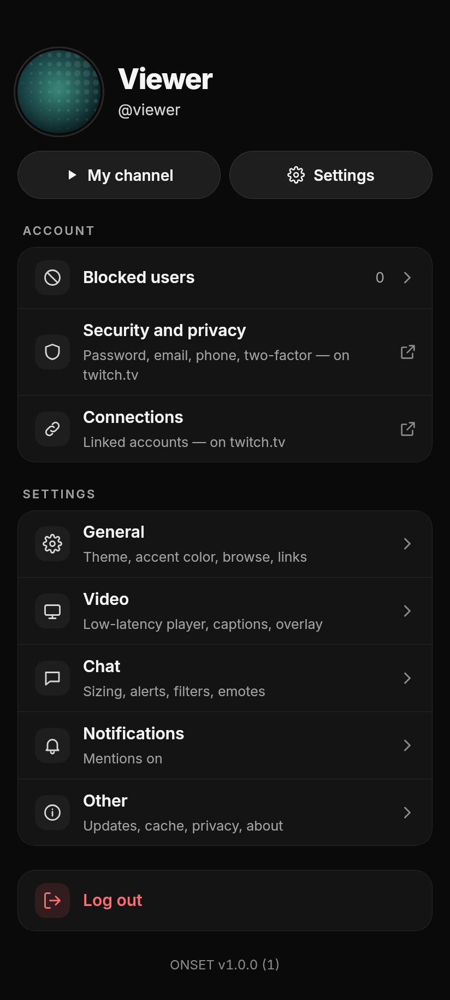
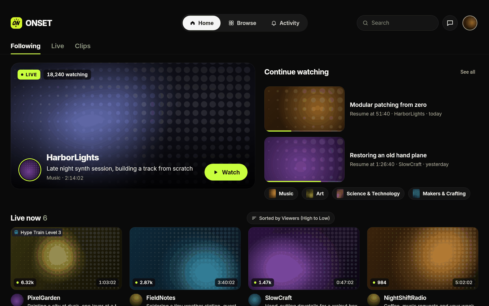
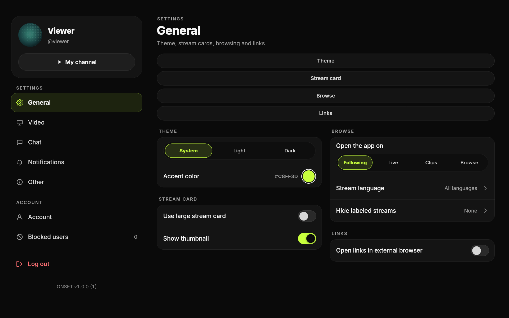

<div align="center">

<picture>
  <source media="(prefers-reduced-motion: reduce)" srcset=".github/assets/onset-logo.png">
  
</picture>

<h1>ONSET</h1>

<p><strong>A Twitch client for Android, close to the live edge.</strong><br>
An Android Twitch client built with Flutter: a native low-latency player and a full-featured chat.</p>

<p>
  
  
  <a href="LICENSE"></a>
</p>

</div>

---

## Why ONSET

The Twitch web player, embedded in an app, keeps the picture several seconds
behind the broadcast. ONSET plays live streams with the **Amazon IVS player**
instead, built on the same video technology as Twitch, and keeps it near the
live edge.

- **Native player by default.** On Android, live channels open in the IVS
  player, drawn into a Flutter texture. It speeds up slightly or jumps ahead
  (your choice) when it falls behind, and reloads if it drifts too far.
- **A fallback that always plays.** The Twitch web player stays one switch
  away in *Settings › Video*. If the native player cannot get the stream or
  fails, the channel switches to the web player on its own, so a change on
  Twitch's side does not leave you without video.
- **Latency you can see.** The player overlay shows the measured delay to the
  broadcaster (on by default); tap it for live video stats. The chat can
  follow that delay, so messages line up with the picture.
- **A head start.** The stream's playback token is requested as soon as you
  press a stream card, before the channel screen opens.

## Features

<table>
<tr>
<td width="50%" valign="top">
<b>Watching</b>
<ul>
<li>Low-latency IVS player, with the Twitch web player as fallback</li>
<li>Latency pill and video stats in the overlay</li>
<li>Picture-in-picture, a floating mini player, background audio</li>
<li>Landscape and full screen, with side or overlay chat</li>
<li>Past broadcasts with chat replay, clips, followed videos</li>
</ul>
</td>
<td width="50%" valign="top">
<b>Chat</b>
<ul>
<li>7TV, BetterTTV and FrankerFaceZ emotes and badges</li>
<li>Emote menu, autocomplete for emotes and mentions</li>
<li>Moderation tools, deleted-message reveal, timeouts and bans</li>
<li>Chat delay synced to the stream, recent message history</li>
<li>Chatter list, filters and muted keywords</li>
</ul>
</td>
</tr>
<tr>
<td valign="top">
<b>Discovery</b>
<ul>
<li>Following, with Continue watching and followed categories</li>
<li>Live and top streams, categories, search, channel profiles</li>
<li>Hype trains, raids, polls, predictions, channel points, whispers</li>
</ul>
</td>
<td valign="top">
<b>App</b>
<ul>
<li>Phone and tablet layouts, light and dark themes, custom accent</li>
<li>Follows the system's reduce-motion setting</li>
<li>Go-live and mention notifications, schedule reminders</li>
<li>Optional in-app updates from this repository's releases</li>
</ul>
</td>
</tr>
</table>

## Screenshots

<table>
<tr>
<td width="33%" align="center" valign="top">
<br>
<sub>Following</sub>
</td>
<td width="34%" align="center" valign="top">
<br>
<br>
<sub>Player overlay and chat</sub>
</td>
<td width="33%" align="center" valign="top">
<br>
<sub>Profile and settings</sub>
</td>
</tr>
</table>


<p align="center"><sub>Following on a tablet</sub></p>


<p align="center"><sub>Settings on a tablet</sub></p>

<sub>Rendered from the app's own widgets with sample channels; stream previews
and avatars are placeholder art.</sub>

## Getting started

1. Install Flutter **3.38.4** (Dart 3.10.3). Newer releases break
   `extended_text_field` and `simple_icons`; older ones break `app_links`.
2. Register an application in the
   [Twitch developer console](https://dev.twitch.tv/console) to get a
   **Client ID** and a **Client Secret**.
3. Copy `.env.example` to `.env` and fill in `CLIENT_ID` and `SECRET` (the
   VS Code launch configurations read it with `--dart-define-from-file=.env`).
4. Fetch the dependencies and generate the MobX / JSON code:

   ```bash
   flutter pub get
   dart run build_runner build --delete-conflicting-outputs
   ```

5. Run or build:

   ```bash
   flutter run --dart-define=CLIENT_ID=<id> --dart-define=SECRET=<secret>
   flutter build apk --release --dart-define=CLIENT_ID=<id> --dart-define=SECRET=<secret>
   ```

   A release build without `android/key.properties` is signed with the debug
   key.

The native player is Android-only (6.0 and later). The Dart code stays
iOS-compatible, and iOS plays through the web player.

### Firebase (optional)

No Firebase project is committed. Without configuration the app runs with
crash reports, analytics and performance traces off, and the "Share crash logs
and analytics" setting has no effect. To enable them, create your own Firebase
project with an Android app `app.onset` (and an iOS app `app.onset` if needed)
and pass:

```bash
--dart-define=FIREBASE_API_KEY=<api key>
--dart-define=FIREBASE_APP_ID_ANDROID=<1:…:android:…>
--dart-define=FIREBASE_APP_ID_IOS=<1:…:ios:…>
--dart-define=FIREBASE_MESSAGING_SENDER_ID=<project number>
--dart-define=FIREBASE_PROJECT_ID=<project id>
--dart-define=FIREBASE_STORAGE_BUCKET=<bucket>   # optional
```

Placing your `google-services.json` in `android/app/` (git-ignored) also
applies the Firebase Gradle plugins (Crashlytics mapping upload, automatic
performance traces); the dart-defines are still what starts Firebase, and
native collection stays off until the app applies the setting. The update
workflow passes the same values from the `FIREBASE_*` repository secrets when
they exist.

## In-app updates

Each push to `main` can build a signed arm64 APK and publish it as a
`build-N` release of this repository, with its SHA-256. Builds made by that
workflow check the latest release, download the APK, verify it and hand it to
the Android installer; local builds never check. The one-time setup (signing
key, secrets, public or private repository) is in
[docs/MISES_A_JOUR.md](docs/MISES_A_JOUR.md) (in French).

## Project structure

```
lib/
  apis/        HTTP services (all extend BaseApiClient)
  models/      data models, with generated .g.dart files
  screens/     one folder per feature, with its own stores/ and widgets/
  services/    playback, real-time sockets, notifications, updates
  stores/      global MobX stores
  widgets/     widgets shared by several features
android/       host app and the native IVS player bridge (Kotlin)
packages/      simple_pip_mode (vendored)
test/          mirrors lib/
tool/          developer scripts (the mark's bitmaps, README media)
docs/          architecture and update setup
```

The layers, the player engines and their fallback, the stores and the chat are
described in [docs/ARCHITECTURE.md](docs/ARCHITECTURE.md).

## Development

```bash
flutter analyze   # must stay clean
flutter test      # must stay green
dart run build_runner build --delete-conflicting-outputs   # after changing a store or a model
```

- State management is [MobX](https://mobx.netlify.app/): rerun `build_runner`
  after changing a store or a `@JsonSerializable` model, and commit the
  generated `.g.dart` files.
- Code style: package imports (`package:onset/...`), single quotes, trailing
  commas. Feature stores live in `lib/screens/<feature>/stores/`.
- Commits: lowercase, no prefix, one change each (for example
  `fix landscape bottom padding in chat bottom bar`).
- CI runs `flutter analyze` and `flutter test` on every pull request to
  `main`.
- README media live in `.github/assets/`. `python3 tool/readme_logo.py`
  rebuilds the animated logo from the app icon
  (`assets/icons/icon_onset.png`), and
  `python3 tool/readme_shots/render.py` renders the screenshots.

## Contributing

Bug reports and feature requests are welcome through the issue templates.
For a pull request, keep it to one change, run `flutter analyze` and
`flutter test` first, and describe what you checked on a device.

## License

ONSET is a modified version of an AGPL-3.0 licensed open-source Twitch client.
It is distributed under the [AGPL-3.0-or-later](LICENSE).
`packages/simple_pip_mode` is a vendored copy of the MIT-licensed
`simple_pip_mode` plugin (see its `LICENSE`).

ONSET is an independent project. It is not affiliated with, endorsed by or
sponsored by Twitch Interactive, Inc. Twitch is a trademark of Twitch
Interactive, Inc.
